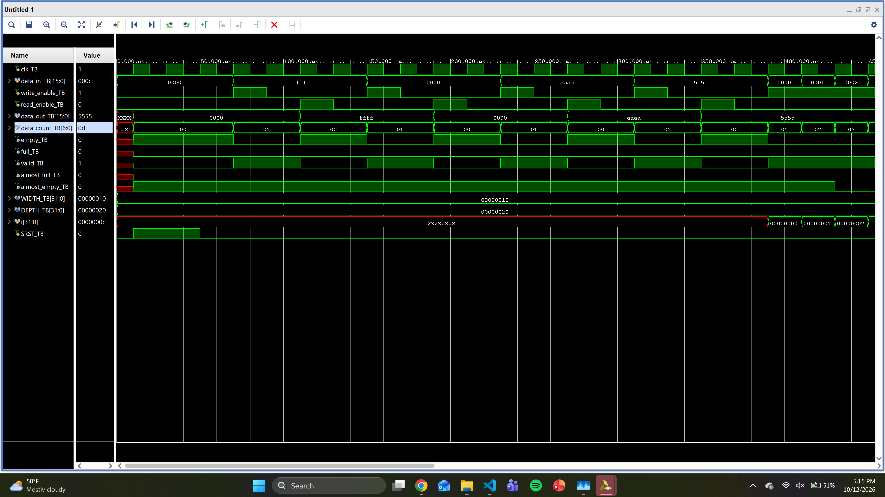
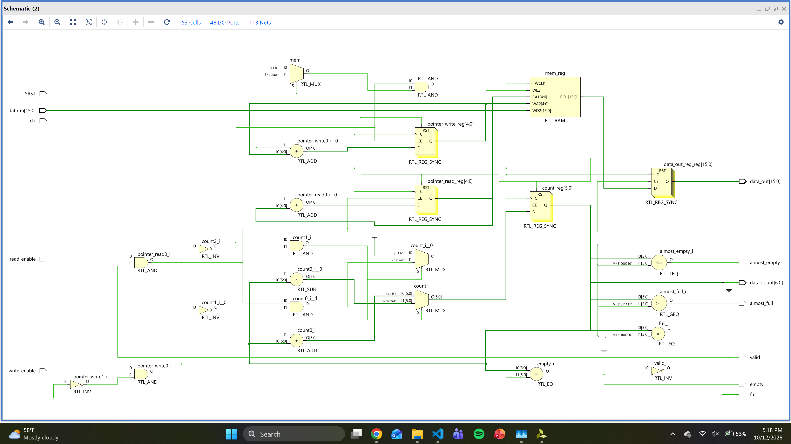

# Overview
During this lab we will create a First-In First-Out (FIFO) queue that uses Block RAM (BRAM) for its internal memory. We will also verify the FIFO design with a testbench (sc_fifo_TB.v) and a Python script.

# Design Summary
The FIFO is implemented as a single-clock synchronous design (sc_fifo.v) with configurable width, depth, and threshold parameters. 

**Inputs:** `clk`, `SRST`, `data_in`, `write_enable`, `read_enable`  
**Outputs:** `data_count`, `valid`, `data_out`, `almost_full`, `almost_empty`, `full`, `empty`

The internal memory is inferred as BRAM by Vivado through a synchronous 2D register array. Status flags are driven combinationally from a running count register.

# Verification and Testing
### Test Cases:

Reset -  Asserts SRST for two clock cycles and verifies empty = 1 and data_count  = 0 after reset.

Write/Read All 1's and 0's - Writes 0xFFFF then 0x0000 and reads each back to verify 'data_out' matches.

Alternating Bit Patterns - Writes 0xAAAA and 0x5555 and reads each back to verify no bit corruption.

Write/Read All 32 locations - Fills all 32 FIFO entries using a for loop and verifies full = 1, then drains all entries and verifies empty  = 1.

Status Flags - Verifies empty, almost_empty, almost_full and full asserts at the correct fill levels (0,2,31,32 entries).

Write Enable Blocked - Confirms data_count does not change when write_enable = 0.

Read Enable Blocked - Confirms data_count does not change when read_enable =0.

### Simulation Screenshot showing all Test Cases:

### RTL Screenshot of FIFO

# Known Issues and Limitations
No Known Issues.
# References
The link was used to understand the 'always' block sytnax for clock generation in the testbench: 
https://chipverify.com/verilog/verilog-always-block

The link was used to understand the 'finish' system task for ending simulation in the testbench:
https://chipverify.com/verilog/verilog-stop-finish
